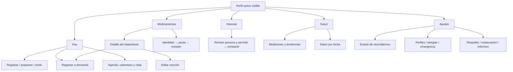

# Pill O-Clock — auditoría integral de UI/UX

**9 de octubre de 2026 · Código revisado: `c820ad2` · Análisis y propuesta, sin cambios en la aplicación.**

La principal oportunidad es convertir una app con muchas funciones útiles en una experiencia que permita **entender qué corresponde a cada persona, registrar con confianza y comprobar qué ocurrió**. El diseño tiene una identidad aprovechable, pero hoy varias acciones incumplen lo que dicen sus botones, algunas pantallas calculan datos distintos y los recorridos secundarios compiten con la tarea cotidiana. Una renovación estética debe apoyarse en la corrección de esos contratos.

El resultado incluye inventarios de acciones y estados, hallazgos con referencias al código, propuestas por pantalla, criterios de aceptación, dirección visual y una secuencia de implementación. No se asigna una nota numérica de usabilidad: no hubo un estudio con usuarios que la sustente.

## Cómo leer la entrega

| Documento | Contenido |
|---|---|
| Este informe | Diagnóstico transversal, prioridades, arquitectura, contratos de interacción, plan y verificación |
| [Medicamentos, dosis y alarmas](uiux-audit-2026-10-09-medications.md) | Inventario detallado del ciclo de tratamiento, PRN, stock, formularios, escáner, sitios y 34 hallazgos |
| [Salud, historial, agenda y emergencias](uiux-audit-2026-10-09-health-agenda.md) | Acciones y estados de mediciones, diario, citas, calendario, informes y alergias |
| [Onboarding, Ajustes y accesibilidad](uiux-audit-2026-10-09-settings-accessibility.md) | Permisos, perfiles, bloqueo, respaldo, integraciones y patrones transversales; 21 hallazgos y riesgos por verificar |
| [Evaluación visual y sistema propuesto](uiux-audit-2026-10-09-visual.md) | Jerarquía, color, tipografía, contraste calculado, contenido y criterios visuales |
| [Lámina conceptual](uiux-audit-2026-10-09-concept.png) · [SVG editable](uiux-audit-2026-10-09-concept.svg) | Cuatro pantallas propuestas con datos ficticios; no es una implementación |

Los anexos se solapan deliberadamente en puntos como informes, perfiles y alarmas. **No se suman sus cantidades como defectos únicos.** Los IDs permiten rastrear cada recomendación a su evidencia.

## Alcance y método

Se revisaron las **13 pantallas con ruta propia**, los componentes interactivos y servicios que determinan sus resultados. El inventario abarca acciones visibles, navegación, menús, cambios de estado, cancelación, permisos, guardado, errores, acciones externas y vacíos. Se distingue producción de controles exclusivos de desarrollo.

| Pantalla/ruta | Acciones cubiertas | Anexo principal |
|---|---|---|
| `/onboarding` | Avanzar, deslizar, omitir, configurar permisos, abrir ajustes del sistema, comenzar | Ajustes |
| `/(tabs)/index` | Perfil, accesos, racha, refrescar, tomar, omitir/motivo, posponer, reprogramar, deshacer, notas, sitio, PRN, bienestar, citas | Medicamentos |
| `/(tabs)/medications` | Crear, editar, pausar, reactivar, archivar/motivo, restaurar, eliminar, PRN, refrescar | Medicamentos |
| `/medication/new` | Nombre/autocomplete/escáner, cantidad/unidad/categoría, frecuencia, fechas/régimen, alarmas/días, extras, stock, foto/color, pasos y guardado | Medicamentos |
| `/medication/[id]` | Carga/inexistente, edición, validación, cancelación, descarte y actualización | Medicamentos |
| `/alarm` | Apertura fría, perfil, cantidad/voz, toma, omisión, posposición, nota, co-dosis, salida, acciones rápidas | Medicamentos |
| `/(tabs)/history` | Semana/mes, período, métricas, listado, insights y compartir PDF | Salud |
| `/(tabs)/calendar` | Cambiar mes/día, consultar dosis, marcar tomada/omitida sólo hoy, indicadores de citas y volver | Salud |
| `/(tabs)/appointments` | Próximas/pasadas, crear/editar/eliminar, fecha/hora, médico, lugar/mapa, notas, recordatorio, detalle y documentos | Salud |
| `/(tabs)/health` | Mediciones/diario, tipo/detalle/tendencia, registrar/borrar, fecha y valores, recordatorio, check-in y edición | Salud |
| `/allergies` | Consultar, buscar ingrediente, introducir texto, guardar, borrar, volver | Salud |
| `/emergency` | Identidad, alergias, medicación, contacto/llamada y volver; acceso exento del bloqueo | Salud |
| `/(tabs)/settings` | Permisos, sonidos, posponer por defecto, bloqueo, perfiles, alergias/emergencia, Health Connect, exportar/importar/cifrar, PDF/cuidador/FHIR, idioma, catálogo, tema, texto grande, voz, versión, privacidad y borrado | Ajustes |

También se incluyen las hojas de nota, motivo, posposición, sitio, cita, ubicación, perfil, contraseña, color RGB y cámara; el tour; mensajes de estado; error de arranque; y las superficies Android fuera de la app. La landing pública de `docs/` no forma parte del producto móvil auditado.

**Evidencia utilizada:**

- Lectura del código actual y contraste entre UI, store, base de datos y servicios. “Confirmado por código” identifica una ruta determinista, no una sesión completa de uso en dispositivo.
- Inspección visual de 56 capturas históricas del 21 de julio; permiten evaluar el antecedente y se contrastaron con cambios posteriores. No se trasladan automáticamente sus defectos al presente.
- Comprobaciones auxiliares en Pixel 9 emulado, Android, APK **1.7.0/code 35** del 27 de julio; el repositorio declara **code 36**. Se inició con `-read-only -no-window -no-snapshot-save`, sin persistir las modificaciones de la prueba. Se estabilizaron pantalla y árbol para verificar Cancelar y el diálogo de Archivar. No se reconstruyó el APK del HEAD.
- Cálculos de contraste sobre valores sRGB del código. Comparación con fuentes primarias de accesibilidad.
- Validación puntual del núcleo de resumen para cuidador, documentada en el anexo de Salud. No constituye una validación clínica.

No se probaron todos los flujos en ambos sistemas operativos ni con participantes. Los riesgos de tamaño de pantalla, lectores, mapas, recursos del SO y entrega de alarmas quedan expresamente sujetos a las pruebas indicadas. “Exhaustivo” describe la cobertura del inventario y la revisión, no una garantía de ausencia de otros defectos.

## Prioridades que deben preceder al rediseño

**P1** significa resolver antes de renovar o publicar el flujo afectado: cambia registros contra la intención, contradice datos esenciales, oculta una acción necesaria o impide recuperar un resultado. **P2** cubre comprensión, descubrimiento, consistencia y calidad visual. No se afirma un incidente real ni un P0 generalizado. Algunos P1 son bloqueos de entrega por su relevancia para la confianza y el significado de la información.

| Orden | Problema y consecuencia | Evidencia | Corrección concreta / aceptación |
|---:|---|---|---|
| 1 | **Cancelar registra una omisión.** Un usuario que quiso salir altera historial y recordatorios | MED-01; `DoseCard.tsx:567`; reproducido también APK35 | Cancelar sólo cierra. Botón, Atrás, gesto y backdrop dejan datos y alarmas iguales |
| 2 | **Una misma dosis muestra cantidades diferentes.** Inicio/notificación aplican la etapa; alarma/voz usan la cantidad base. Calendario y ficha también requieren unificación | MED-04; anexo Salud; `useTodaySchedule.ts:58`, `alarm.tsx:106,302`, `calendar.tsx:201`, `emergency.tsx:115` | Modelo de dosis por fecha compartido; todas las superficies coinciden en cantidad/unidad y perfil |
| 3 | **La ficha dice “Sin alergias conocidas” sin evidencia de esa afirmación**, incluso durante carga | `emergency.tsx:32,88-89`; anexo Salud | Estados separados: cargando, error, no registradas y ausencia expresamente confirmada, con fecha |
| 4 | **El resumen del cuidador incluye dosis que no corresponden hoy** e ignora registro pospuesto al cruzar por hora | `caregiverSnapshot.ts:71-80`; anexo Salud | Misma función de vigencia que Inicio; cruce por identificador y fecha. Probar fin de tratamiento, descanso, etapa y posposición |
| 5 | **Health Connect carece de control de persona propietaria** | SA-11; `healthSync.ts:25,65`; `health.ts:32` | Asignar un perfil al dueño del teléfono; otra persona no se copia a ese repositorio |
| 6 | **“Única vez” puede guardar horarios ocultos** | MED-02; `MedicationForm.tsx:479,1194` | Lo revisado antes de guardar coincide exactamente con los horarios persistidos |
| 7 | **Archivar pierde Otro y Cancelar en Android** | MED-03; `medications.tsx:43-53`; comprobado APK35 y RN instalado | Hoja con motivos y cancelación explícita, confirmación separada y misma capacidad en ambas plataformas |
| 8 | **El respaldo omite parte de los registros/archivos y la restauración pierde campos** | SA-07…10; `backup.ts:193-203`; `database.ts:952,1201` | Copia y restauración con manifiesto/totales, adjuntos transportables y paridad de campos; vista previa de conflictos |
| 9 | **Atrás en contraseña se interpreta como exportar sin cifrar** | SA-06; `PassphraseModal.tsx:38`; `settings.tsx:347` | Resultados distintos para cancelar, exportar sin contraseña y cifrar; sólo una elección explícita abre el destino |
| 10 | **Recordatorios sin diagnóstico completo** y permisos fallidos que pueden parecer concedidos | SA-01…02; `settings.tsx:301,498` | Comprobar notificaciones, exactitud y pantalla completa cuando corresponda; estado reparable y prueba controlada |
| 11 | **Inicio oculta PRN en días sin dosis; posponer y reactivar dejan estados inconsistentes** | MED-05…07 | PRN independiente; horario efectivo para estado; reactivación actualiza horarios sin reinicio |
| 12 | **Guardar/refrescar/compartir pueden aparentar éxito o fracaso equivocado**; mediciones admiten interpretación numérica ambigua | MED-10,23,26; SA-10,14; anexo Salud | Esperar resultado, bloquear doble envío, conservar borrador, normalizar números y ofrecer reintento contextual |

La prioridad 8 incluye que Borrar todo conserva atributos del perfil principal y puede dejar un perfil activo inexistente. La prioridad 12 incluye el caso de mediciones retroactivas que alteran qué valor aparece como último. El anexo correspondiente contiene las secuencias y aceptación completa.

## Qué elevar en cada pantalla

| Pantalla | Oportunidad principal | Comportamiento propuesto |
|---|---|---|
| Inicio | Próxima acción y sensación de control | Hora efectiva primero; próxima dosis destacada; pendientes de registrar separadas; completadas compactas; PRN siempre disponible; bienestar/citas después |
| Medicamentos | Escanear el tratamiento sin administrar todo desde la lista | Búsqueda, activo/pausado/archivado; nombre completo y pauta breve; tocar abre detalle; editar/archivar/borrar con jerarquía distinta |
| Alta | Configurar con comprensión, sin decisiones cosméticas intermedias | Identidad → pauta → revisión. Opciones avanzadas plegables; saltar a error; primera alarma y persona visibles antes de guardar |
| Edición | Corregir una parte rápidamente | Secciones editables, resumen de cambios de pauta y consecuencias en recordatorios; protección de borrador al salir |
| Alarma | Resolver con poco esfuerzo y sin ambigüedad | Persona, nombre, dosis efectiva y hora; acciones “Registrar toma”, “Posponer recordatorio”, “Omitir”; scroll y salida neutral; errores conservan contexto |
| Historial | Comprender los registros y compartir el período adecuado | Indicador con denominador/ventana claros; estados consistentes; filtros; registro completo y exportación con identidad/alcance |
| Calendario | Entender qué pasó o está programado un día | Fecha seleccionada evidente; volver a Hoy; leyenda textual; dosis y citas del día; registrar pasado con hora y confirmación claras |
| Citas | Preparar la consulta y acceder a su documentación | Próximas/pasadas según fecha y hora local; crear desde vacío; recordatorio inequívoco; lugar editable aun sin mapa; documentos con estado/recuperación |
| Salud/mediciones | Registrar con precisión y leer tendencias | Tipo, unidad y fecha antes de guardar; coma decimal; errores de formato; último valor por fecha; gráfico con tiempos reales y alternativa de datos |
| Salud/diario | Registro breve y continuidad | Bienestar, síntomas y nota opcional; acceso por fecha a todo el diario; mostrar “Ver más”; guardar/editar con feedback persistente |
| Alergias | Mantener información comprensible y revisable | Perfil visible; catálogo/manual explícitos; severidad y notas; sin registros no significa ausencia clínica confirmada |
| Emergencia | Información esencial identificada y veraz | Persona elegida expresamente, vigencia, estado de alergias, cantidades actuales y contacto; explicar visibilidad sin desbloqueo y permitir configuración |
| Ajustes | Encontrar una configuración por intención | Grupos “Recordatorios”, “Personas”, “Datos y respaldo”, “Accesibilidad y apariencia”, “Acerca de”; cada grupo muestra un resumen verificable |

Los accesos que ya se mejoraron —Historial en pestaña, labels en Inicio, PRN en la tarjeta, presets de posponer y compartir PDF— se conservan. La auditoría de julio ya los marcaba resueltos y el código actual lo confirma. No conviene reintroducirlos como tareas pendientes.

## Arquitectura propuesta

Mantener cinco pestañas evita aumentar la carga de navegación. No es necesario reordenarlas sin medir el coste para quienes ya usan la app. La mejora central es conectar destinos por tarea y hacer persistente el contexto de persona.

“Agenda” puede reunir las dos vistas secundarias bajo Calendario/Citas, accesible desde Hoy y fechas del historial. Es una propuesta de arquitectura, no una solicitud de agregar una sexta pestaña. La prioridad es que tocar un indicador de cita muestre esa cita y no un listado de dosis ajeno a la expectativa.

## Contratos para todas las acciones

| Tipo | Regla de interfaz | Resultado verificable |
|---|---|---|
| Navegar | Nombre del destino, volver predecible, fallback si no hay historial | Abrir desde notificación no termina en una pantalla vacía |
| Cancelar/cerrar | No escribir datos ni iniciar operaciones externas | Cancelar, Atrás y backdrop equivalentes; cambios pendientes piden descarte sólo cuando aplica |
| Registrar | Persona, objeto, cantidad/hora y resultado visibles | Un toque crea un registro; doble toque no duplica; error conserva contexto |
| Posponer | Cambia el recordatorio, no declara que la dosis fue tomada/omitida | Mostrar hora y fecha resultantes; estado coherente tras reinicio/segundo plano |
| Deshacer | Revertir exactamente la modificación realizada | Stock, historial y alarmas vuelven al estado previo real, incluido stock cero |
| Pausar/archivar/borrar | Explicar diferencia y consecuencias; preservar historial donde se promete | Motivos opcionales, cancelar disponible, estados y recordatorios coherentes |
| Elegir opción | Nombre/rol/valor/estado accesibles | Tema, idioma, perfil, día y sonido anuncian selección y se aplican realmente |
| Compartir | Revisar persona, período, contenido y fecha antes de abrir hoja del SO | La app afirma archivo generado/hoja abierta; no afirma que fue recibido por alguien |
| Restaurar/borrar todo | Mostrar alcance concreto y resolución de conflictos | Perfil activo válido, resultado real, datos anunciados restaurados o eliminados |
| Pedir permiso | Solicitar cuando aporta, explicar función y recuperar denegación | “Omitir” no produce una solicitud inesperada; error de consulta no equivale a concedido |

### Estados mínimos compartidos

Cada lista y formulario debe distinguir: carga inicial, datos disponibles, vacío de primera vez, vacío por filtro/fecha/perfil, error recuperable y operación en curso. Un indicador “0” antes de cargar puede informar algo falso. Guardado parcial necesita explicar qué se completó y qué requiere reintento, particularmente los recordatorios.

Separar además tres ejes del registro de dosis: **programación original**, **siguiente recordatorio** y **declaración registrada**. La hora pasada por sí sola no prueba que una persona no tomó el medicamento. El estado mostrado debe representar lo que la app sabe; no convertirse en una indicación de tomar una dosis retrasada.

## Superficies fuera de las pantallas

| Superficie / acción | Resultado actual y evaluación | Recomendación / aceptación |
|---|---|---|
| Notificación: tocar cuerpo | Abre alarma con medicamento/fecha; cold start y bloqueo tienen manejo específico | Identidad/cantidad coherentes, retorno seguro y no mostrar onboarding sobre la alarma |
| Notificación: confirmar, omitir, posponer | Acciones rápidas; Android puede arrancar JS; posponer usa preferencia | Feedback comprobable al abrir, idempotencia y recuperación de error; validar app cerrada, bloqueo y sin red |
| Notificación: descartar / expiración de sonido | Servicio Android deja recordatorio silencioso y rearma hasta límite (`AlarmAudioService.kt:254-316`) | No tratar descarte como toma; la app explica el estado del recordatorio sin afirmar persistencia ilimitada |
| Widget: consultar | **UX-X1 · P1:** `index.tsx:121-127` envía `name:null` si no hay pendientes; `PillWidgetProvider.kt:46` presenta “All done” tanto si todo se completó como si todas están sin registrar o no hay datos | Distinguir sin tratamiento, sin dosis hoy, pendientes de registrar y completado. Ausencia de próximo evento no significa completado |
| Widget: hora/perfil | **UX-X2 · P1:** se envía `scheduledTime`, no `snoozedUntil`, y no hay campo de persona. Actualización sólo desde efecto de Inicio; `pill_widget_info.xml` tiene período 0 | Mostrar persona y hora efectiva; definir refresco cuando el dato cambia. Validar sin abrir Inicio, cambio de perfil y pasada de día; la obsolescencia efectiva requiere prueba |
| Widget: tocar | Abre actividad principal, no una dosis específica (`PillWidgetProvider.kt:59-70`) | Mantener el área tocable grande; aterrizar en Hoy con contexto visible. No presentar acción de registro instantáneo que el widget no tiene |
| Widget: idioma | **UX-X3 · P2:** “All done” y “Next:” hardcoded en inglés (`:47,54`) | Idioma de app consistente, formato horario local; cubrir ES/EN/PT y cambio con widget instalado |
| Solicitud de reseña | **UX-X4 · P2:** `requestReview()` se llama dentro de `markDose`, antes de `loadTodayLogs` (`medications.ts:281-286`) | Pedir tras completar el feedback de la tarea, en un momento neutral. Interrupción real depende del SO y debe observarse |
| Documentos externos / llamadas / política | Abren otra app o una acción del SO | Indicar qué se abrirá, preservar estado al regresar y ofrecer salida/recuperación si el recurso ya no existe. No se efectuaron llamadas ni envíos |

Los idiomas de notificación nativa se resuelven por recursos Android de dispositivo (ES/EN) y pueden diferir de la elección interna; ver SA-17. También hace falta verificar la exportación en iOS: la copia actual utiliza SAF de Android; el anexo distingue la evidencia del código de la prueba pendiente.

## Dirección visual

La propuesta conserva la cápsula con reloj y el azul. Introduce una línea temporal como estructura de Hoy y limita el color de medicamento a una marca de identidad. La persona y la hora tienen jerarquía; los metadatos y ajustes administrativos ceden espacio. Se reducen sombras y contenedores repetidos, sin perder separación de tareas.

El [anexo visual](uiux-audit-2026-10-09-visual.md) define paleta, roles de color, tipografía nativa escalable, espaciado, controles, copy y cuatro pantallas modelo. Los botones con blanco sobre primary en modo oscuro dan **2,788:1** o **2,542:1** según origen del token; deben tener colores distintos para texto y relleno. El muted claro actual sí supera 4,5:1 y no requiere cambio por contraste.

Tomar como referencia contraste mínimo de texto de [W3C](https://www.w3.org/WAI/WCAG22/Understanding/contrast-minimum), controles de al menos 48 × 48 dp como objetivo [Android](https://developer.android.com/guide/topics/ui/accessibility/views/apps-views) y tamaño predeterminado 44 × 44 pt de [Apple](https://developer.apple.com/design/human-interface-guidelines/accessibility). Son referencias de diseño y aceptación, no una declaración de conformidad ya alcanzada.

## Secuencia de implementación

| Fase | Alcance y entregable | Dependencias / salida |
|---|---|---|
| **1. Recuperar confianza** | Cancelar/archivar, cantidad efectiva compartida, vigencia del cuidador, alergias con estados reales, control de persona en Health Connect, respaldo/restauración, perfil válido y cancelación de cifrado | Ninguna pantalla contradice el registro o la persona. Casos de integridad verificables antes de cambiar layouts |
| **2. Recorrido cotidiano** | Contratos de dosis/recordatorio, PRN visible, reactivación, deshacer/stock, feedback/errores; centro de recordatorios y widget consistente | Modelo temporal/identidad de fase 1; validación con alarmas y app cerrada |
| **3. Sistema visual y configuración** | Tokens únicos, componentes accesibles, Hoy, lista/detalle, alta de tres etapas/revisión, edición directa y borradores | Componentes comunes primero; rollout por flujo completo, no cambios sueltos de padding |
| **4. Continuidad del cuidado** | Agenda/citas/documentos, salud/diario/gráficos, historial/exportaciones con alcance, onboarding contextual y simplificación de Ajustes | Identidad y exportación corregidas; pruebas con usuarios, iOS y texto aumentado |

No se estiman fechas sin conocer equipo, disponibilidad y distribución Android/iOS. Los cambios de tokens/copy son pequeños; el modelo común de dosis, el respaldo portable y los flujos de formularios son trabajo de varios componentes con validación propia. No conviene iniciar todos en paralelo si dependen del mismo estado.

## Verificación que convierte el rediseño en una mejora demostrable

### Casos funcionales obligatorios

| Grupo | Escenarios y resultado esperado |
|---|---|
| Cancelación | Cancelar omisión/archivo/contraseña por todos los mecanismos: cero cambios, cero exportación iniciada |
| Régimen | Diario, semanal, cada N, ciclo, mensual y etapas; antes del inicio/después del fin; misma cantidad/estado en Hoy, alarma, calendario, voz e informes |
| Recordatorio | Posponer/reprogramar, cruzar medianoche, volver desde segundo plano, reiniciar, permiso revocado; hora efectiva y acciones correctas |
| Registro | Tomar/omitir/deshacer, doble toque, error de escritura/programación; sin duplicados y con resultado real |
| Stock | Cero, uno, fracciones/configuración de consumo; ida y vuelta de registro no crea inventario |
| PRN | Perfil sólo PRN, día de descanso, límite alcanzado, intervalo >48 h, registro/reversión visible |
| Perfiles | Cambio rápido, alarma de otra persona, reset/importación; nunca una persona inexistente o una medición de otro en Health Connect |
| Emergencia | Sin carga, error, sin registros, ausencia confirmada y alergias existentes; el texto no informa falsa ausencia |
| Backup | >90 check-ins, >9.999 mediciones, dos perfiles, default personalizado, fotos, adjuntos y sitios; restaurar en entorno nuevo y comparar campos/totales |
| Fusión | Copia antigua, mismos IDs, importar dos veces, conflicto de estado y error parcial; resumen honesto de cambios |
| Mediciones | Coma/punto decimal, caracteres extra, campo vacío, unidad y registro retroactivo; orden cronológico correcto |
| Agenda | Cita hoy antes/después de hora, zona Argentina 21–24 h, día seleccionado con cita sin dosis, mapa denegado y adjunto ausente |
| Widget | Todo tomado, omitido, sin registrar, sin dosis, PRN, pospuesto, cambio de día/persona/idioma |

### Casos visuales y accesibles

Android e iOS; claro y oscuro; ancho 320/360/430; fuente estándar y 200 %; modo de texto grande; nombres largos; varios medicamentos a la misma hora; teclado abierto; gesto y botones del SO; orientación donde se permita; movimiento reducido; lector de pantalla. Verificar nombre/rol/estado, orden de foco, apertura/cierre de modales, anuncios de resultado y alternativa textual del gráfico. No inferir accesibilidad sólo por presencia de `accessibilityLabel`.

### Prueba de usabilidad propuesta

Realizar sesiones moderadas con una persona nueva, alguien con varios medicamentos y un cuidador; incluir personas mayores o con baja visión. Pedir, sin tour, que agreguen una pauta, encuentren la próxima dosis, registren y deshagan, pospongan, usen PRN, creen una cita, registren una medición, compartan un período y restauren una copia.

Medir éxito sin ayuda, toques, tiempo, errores de cancelación, confusión de persona/cantidad y necesidad de releer. Objetivos iniciales —**no resultados medidos**—: al menos 90 % de tareas principales sin ayuda, cero registros causados por cancelación, cero confusiones de persona/cantidad y primera medicación simple configurada en dos minutos. Ajustar tiempos tras obtener línea base; los grupos y el tamaño de muestra no permiten prometer significación estadística.

La app declara que no usa analítica de producto. Estos indicadores se pueden obtener en pruebas locales con consentimiento y datos ficticios; no requieren agregar telemetría ni sacar información médica del dispositivo.

## Decisiones de producto para la implementación

Las propuestas anteriores permiten avanzar, pero cuatro definiciones deben quedar explícitas en el diseño: qué significa “Única vez” (una toma o un día), qué unidad consume el inventario, quién es el dueño del repositorio Health Connect y qué perfil/datos se exponen en Emergencia sin desbloqueo. Valores recomendados: una toma, inventario con unidad/consumo explícitos, un único perfil propietario y ficha de emergencia configurada por persona. Validarlos con las reglas del producto antes de codificar cambios que transformen datos existentes.

La renovación debería comenzar por los contratos de interacción y el significado común de los datos. Sobre esa base, la nueva jerarquía visual puede hacer que cada acción sea más rápida, comprensible y confiable.
